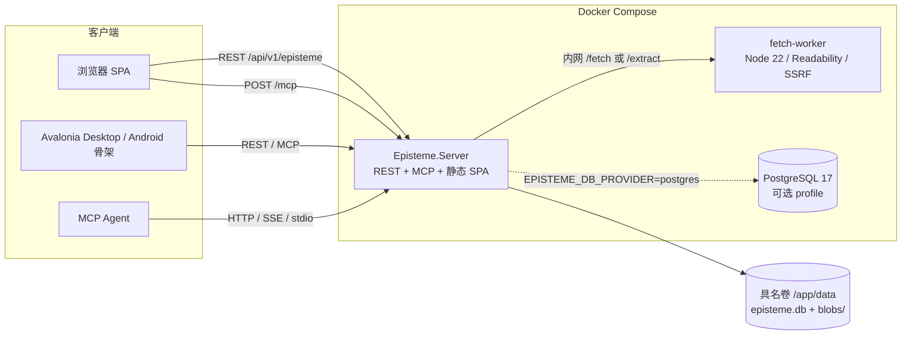

# Episteme · 知书

> **一个没有预设业务语义的通用文档内核**：目录与内容由用户定义，界面 / REST / AI Agent 共用同一份 Schema，四类媒介挂在同一份文档下，每次改动都像 git 一样可追溯、可 diff、可回滚。

Episteme（ἐπιστήμη，希腊语「经论证的知识」）由「商业短篇创作工作台」抽象一层而来：工作台不再是产品本身，而是本平台的第一套内置模板（Pack）。首次启动时内核里没有任何「素材 / 热点 / 报告」等业务名词，只有一个「创建你的第一个空间」。

| 项 | 内容 |
|---|---|
| 当前版本 | v0.5（`0.5.0-polish`，P1–P5 全部落地） |
| 本轮增量 | git 旁路同步：`pack_git-ingest` 模板、`tools/git-sync.py`、公网 secure / Caddy / post-receive 样例（见第 10 节） |
| 服务端 | .NET 10 / ASP.NET Core Minimal API / EF Core 10（SQLite 默认，PostgreSQL 可选） |
| Web 前端 | 原生 SPA（`wwwroot/app.js`）+ 本地 vendored pdf.js 4.10.38 / Monaco 0.52.2，零 CDN |
| Agent 协议 | MCP JSON-RPC 2.0（`2025-06-18`）：Streamable HTTP / SSE / stdio bridge |
| 客户端 | Avalonia 12.1.5 共享壳：Desktop、Android 骨架、无 GUI Probe、McpStdio |
| 抓取 | 独立 Node 22 worker：Mozilla Readability 0.6.0 + linkedom 0.18.15 + SSRF 防护 |
| 部署 | Docker Compose：`api` + `fetch-worker`，可选 `postgres` profile |
| 规格与验收 | `SPEC.md`、`docs/01`–`docs/10`（本轮验收见 `docs/10-v0.5完善与全量验收报告.md`） |

**内容导航**：1 快速开始 · 2 系统设计 · 3 功能清单 · 4 构建与运行 · 5 使用方法 · 6 接口与协议速查 · 7 测试与验收 · 8 仓库结构与文档 · 9 边界与路线 · 10 从任意位置同步 git 提交
---

## 1. 快速开始

需要 Docker + Docker Compose v2。所有命令都在**仓库根目录**执行（本仓库根即 `Episteme/`，没有 `episteme/` 子目录）。

```bash
docker compose -p episteme -f deploy/docker-compose.yml --env-file deploy/.env up -d --build
```

```bash
curl http://127.0.0.1:5080/health
# {"status":"ok","product":"Episteme","version":"0.5.0-polish","authMode":"legacy","dbProvider":"sqlite",...}
```

浏览器打开 `http://127.0.0.1:5080/` —— 你会看到一个空壳首页。想先不装 Docker 体验交互，直接用浏览器打开单文件原型 `prototype/index.html`，建议按「创建空间 → 装模板 → 自定义目录 / Schema → 四类阅读器 → 版本管理 → MCP 面板 → 主题与窄屏」顺序体验。

> **安全提醒**：`deploy/.env` 默认 `EPISTEME_BIND_IP=0.0.0.0`（局域网可访问）且 `EPISTEME_AUTH_MODE=legacy`（无鉴权，仅靠 `X-Episteme-Role` 头声明角色）。这适合本机 / 内网试用；对公网或不可信网络开放前，请改为 `127.0.0.1` 或启用第 4.4 节的 secure 模式并配置 TLS 终止。

常用运维命令：

```bash
# 看日志 / 停止 / 重启
docker compose -p episteme -f deploy/docker-compose.yml --env-file deploy/.env logs -f api
docker compose -p episteme -f deploy/docker-compose.yml --env-file deploy/.env down
# 回到全新空库（会删除具名数据卷，谨慎）
docker compose -p episteme -f deploy/docker-compose.yml --env-file deploy/.env down -v
```

数据在具名卷 `episteme_episteme-data`（因为项目名固定为 `episteme`），容器内路径 `/app/data`：`episteme.db` 是 SQLite 主库，`blobs/` 存内容寻址的 PDF 原件。`down -v` 会清空全部空间、文档与提交历史。

---

## 2. 系统设计

### 2.1 定位：三层抽象

变的只有数据，不变的是内核：

| 层 | 内容 | 变更频率 |
|---|---|---|
| **L2 模板层 Pack** | 目录树、内容类型、视图、示例数据；`workbench` 只是其中一个 | 用户随时安装 / 导出 / 自建 |
| **L1 媒介层 Viewer** | Markdown / Code / PDF / Web 四类一等公民阅读器与统一 Part 契约 | 内核稳定，可渐进增强 |
| **L0 通用内核 Core** | 空间、目录树、动态 Schema、文档与 Part、版本 DAG、动态 MCP、权限与审计 | 极少变 |

**空壳原则（Empty by default）**：零预置目录、零预置字段、零业务专有名词；界面 / 列表 / 表单 / 索引 / AI 工具全部由用户定义的 Schema 生成。

### 2.2 六条设计原则

1. **Schema 即契约**：字段一改，列表列、表单控件、检索索引、导出结构、MCP 工具签名同步重建，无需发版。
2. **文档是载体，不是格式**：`Document = 元数据 + 1..N 个 Part`；Markdown 正文、代码、PDF 原文、网页快照可同时挂在同一份文档下。
3. **版本是一等公民**：界面、REST、MCP 三条写路径共享同一条 Commit 链，AI 的每次编辑都可 diff / revert。
4. **MCP 动态生成**：`tools/list` 依据当前目录树与 Schema 实时生成；新建内容类型后 Agent 立刻获得对应工具，无需重启。
5. **Agent 改动默认可隔离**：写操作可指定 `branch` 在隔离分支进行，人工审阅后合并；配合 `reason` / `agentId` / `expectParent` / 幂等键避免静默覆盖。
6. **复用而非重写**：鉴权、幂等、审计、三端、Docker、主题令牌均在既有体系上渐进增强，所有生产化开关默认关闭，不破坏 legacy 契约。

### 2.3 概念模型

```text
Space 空间（独立版本 DAG 根 / 权限 / MCP 上下文）
├── Node 目录节点（物化路径树，可绑定 ContentType）
│   └── Document 文档（title + fields[jsonb] + tags）
│       ├── Part(md | code | pdf | web | attachment)
│       └── Annotation 标记（高亮 / 下划线 / 批注 / 区域 / 书签，带稳健锚点）
├── ContentType 内容类型（版本化 Schema：FieldDef[]）
├── Commit 提交（parents[] + treeHash + source + reason + agentId + idempotencyKey）
│   └── Tree 树快照（path → docId / fieldsHash / partHashes / annotations）
├── Ref 引用（branch / tag → commit）
└── Pack 模板（声明式 JSON：目录 + Schema + 视图 + 可选示例数据）
```

`Node` 既可以是纯目录，也可以是「绑定了内容类型的集合」（类似 git 目录 + 数据库表的合体）；目录结构本身就是 Agent 可操作的资源树。实体、字段类型与 DDL 见 `docs/01-概念模型与动态Schema.md`，版本模型见 `docs/02-git式版本模型.md`。

### 2.4 运行时架构



| 组件 | 路径 | 职责 |
|---|---|---|
| `Episteme.Core` | `src/Episteme.Core/` | 零 NuGet 依赖的领域内核：实体、SchemaEngine、内容寻址 diff、PackEngine、Viewer/锚点契约、MCP 工具派生 |
| `Episteme.Server` | `src/Episteme.Server/` | 53 条 REST 路由、MCP JSON-RPC / SSE、EF Core 持久化、secure 中间件、SPA 静态资源与 vendored 阅读器 |
| `worker` | `worker/` | 独立抓取容器：`/fetch` 在线抓取、`/extract` 离线 HTML 快照、正文抽取与白名单清洗，仅 compose 内网可达 |
| 客户端 | `src/Episteme.Client.slnx` | Avalonia 共享 UI / ViewModel、Desktop 入口、无 GUI Probe、MCP stdio 转发桥 |
| 原型 | `prototype/index.html` | 单文件零依赖高保真交互原型，与实现同源的四套浅色主题 |

### 2.5 动态 Schema

`ContentTypeDefinition` 是**校验、动态渲染、MCP 工具签名**的唯一事实来源（`src/Episteme.Core/SchemaEngine.cs`）：

- 支持 15 种字段类型：`text` `longtext` `markdown` `code` `number` `date` `boolean` `select` `multi_select` `tags` `url` `ref` `json` `file` `user`。
- 每个字段可配置 `required` / `unique` / `indexed` / `defaultValue` / `validation`（min、max、integer、正则等）/ `options` / `exposeToMcp` / `mcpWritable`。
- 类型定义带 `version`，升级后新增字段回填默认值、删除字段归档保留；`exposeToMcp=false` 的字段不会出现在任何工具签名里，`mcpWritable=false` 的字段不出现在写工具里。
- `GET /spaces/{id}/nodes/{nodeId}/render` 返回列 / 控件描述，前端据此生成表单；`POST /content-types/{slug}/validate` 复用同一套校验规则。
- Schema / 目录 / Pack 变更会递增 `toolsVersion`（写响应同时回写 `X-Tools-Version` 头）；`tools/list` 每次调用都实时重建，Agent 重新拉取即可看到新工具。设计规格中的 `notifications/tools/list_changed` 主动推送尚未落地。

### 2.6 git 式版本管理（内容寻址快照 DAG）

`Blob`（SHA-256，去重）→ `Tree`（路径 → 哈希快照）→ `Commit`（parents、message、author、source、reason）→ `Ref`（branch / tag）。

- 界面 / REST / MCP 三条写入路径都调用同一个 `WriteCommitAsync`，一次写入 = 一条 Commit + 一条审计记录。
- diff 覆盖**字段级**、**Part 文本逐行**与**标注级**差异；支持 `log` / `diff` / `blame` / `branch` / `merge` / `revert`（生成反向提交，不改写历史）/ `tag` / 导出为 git 线性提交清单。
- 写请求可带 `idempotencyKey`（重放返回原 Commit）、`expectParent`（HEAD 变化返回 `409 CONFLICT_PARENT`）、`source` / `reason` / `agentId` / `actor`，便于审计与追责。
- 选择「git 语义 + 数据库内容寻址」而非真 git 仓库，是为了事务一致性、行级权限、在线并发编辑与 MCP 写原子性；代价是不能直接用外部 git 客户端。
- 所有 `DateTime` 统一 UTC 转换器，保证 SQLite 与 Npgsql（PostgreSQL 17）行为一致；启动执行 `EnsureCreatedAsync()`，当前**没有迁移脚本**。

### 2.7 动态 MCP Server

| 项 | 说明 |
|---|---|
| 静态工具 | 30 个，均以 `episteme.` 为前缀：`list_spaces` / `tree` / `read` / `search` / `create_document` / `append_part` / `annotate` / `viewers` / `read_part` / `export_notes` / `log` / `diff` / `branch` / `merge` / `revert` / `list_packs` / `install_pack` / `export_pack` / `capabilities` / `fetch_web` / `upload_pdf_base64` / `rebind_annotation` 等 |
| 动态工具 | 每个 `exposeToMcp=true` 的类型派生 `episteme.query_{slug}` / `create_{slug}` / `update_{slug}`，JSON Schema 由 FieldDef 直接映射 |
| Resources | 当前实现 `resources/list` 只列 `exposeToMcp` 节点，URI 形如 `episteme://{spaceId}{nodePath}`；`resources/read` 返回提示文本，实际内容读取请用 `episteme.tree` / `episteme.read`。`docs/03` 中 `.../{docId}[/part/{kind}]` 的细粒度 URI 属于设计目标 |
| 传输 | `POST /mcp`（主，JSON-RPC 2.0）、`GET /mcp/sse` + `POST /mcp/messages?sessionId=...`、`src/Episteme.McpStdio`（一行请求 / 一行响应转发） |
| 版本 | `toolsVersion` 单调递增并通过 `X-Tools-Version` 回写；`tools/list` 实时重建，不依赖推送通知 |
| 权限 | 角色经 `X-Episteme-Role` 传递；`agent` 角色默认无权 `define_content_type`（`FORBIDDEN_SCOPE`） |
| 审计 | 每次工具调用记录 `action` / `agentId` / `commitId` / `idempotencyKey`，可经 `GET /spaces/{id}/audit` 查询 |

完整协议见 `docs/03-动态MCP-Server协议.md`，机器可读契约样例在 `design/mcp/`。

### 2.8 统一 Part 契约与四类阅读器

统一 Viewer 契约 `mount / read / edit / annotate / snapshot`；所有写回落到 Part + Commit：

| 媒介 | 阅读 | 编辑 | 标记锚点 | 实现 |
|---|---|---|---|---|
| Markdown | 预览 / 源码 | 可编辑，产生行级 diff | `textQuote` / `line` | 内置预览，渐进增强 |
| Code | Monaco 0.52.2（语言、行号） | 可编辑 | `line` + `textQuote` | 本地 vendored，加载失败降级 textarea |
| PDF | pdf.js 4.10.38 canvas + 文本层 | 原件只读 | `page` + `rect` + `textQuote` | 原件存 `blobs/<sha256>.pdf`，Part 只留 `blob:sha256:<hash>` |
| Web | Readability 正文抽取，阅读 / 原文模式 | 不可编辑，可重抓 | `domPath` + `textQuote` | 独立 worker + HTML 白名单清洗 |

- 锚点写入时归一化并校验（越界行号、不存在的引文、缺定位信息等返回 `422 ANCHOR_INVALID`），带 `fingerprint` / `textPosition` / `fallback`，内容变更后按四级回退自动重定位；丢失的标注不会被静默丢弃，可经 `PUT /annotations/{id}` 交互式重绑定。
- 标注进入不可变版本快照，可被 diff 与 revert 恢复；`POST /exports/notes` 把跨 Part 标注汇总为一份新的 Markdown Part。
- 网页抓取走独立 worker，八类 SSRF 防护：协议、端口、DNS 解析、私网 IP、云元数据地址、逐跳重定向、域名白名单、响应大小 + 超时；单次 `allowedHosts` 只能比全局更严。

详见 `docs/04-四类阅读器与统一Part契约.md`、`docs/08-P3四类阅读器实现与验收报告.md`。

### 2.9 声明式 Pack 模板

Pack 是**纯数据**（目录 + 内容类型 + 视图 + 可选示例数据），安装时不执行任何用户代码，一次事务内创建全部对象并产生一条 `source=import` 的 Commit。

| 内置模板 | ID / 文件 | 内容 |
|---|---|---|
| 商业短篇创作工作台 | `workbench`（`wwwroot/packs/workbench.json`） | 15 个目录 / 12 个内容类型，演示原工作台 11 个模块如何降为模板 |
| 通用阅读台 | `pack_reading-desk`（`wwwroot/packs/reading-desk.json`） | 5 个目录 / 4 个内容类型 + 示例文档，演示同一文档挂 PDF / MD / Web / Code 四种 Part |
| Git 提交归档 | `pack_git-ingest`（`wwwroot/packs/git-ingest.json`） | `/Git 提交` 目录 + `git_commit` 内容类型（17 字段），承接旁路同步写入的提交元数据与文件内容 |

支持 `dryRun` 预览、`overwrite` 覆盖、`includeSamples` 带示例数据、幂等安装（重复安装返回 `409 PACK_CONFLICT`）、导出当前空间为 Pack JSON 再导入到另一个空间；非法模板（ID 非法 / 引用未声明类型）返回 `422 PACK_INVALID`。

### 2.10 安全与持久化

- **legacy（默认）**：不注册任何鉴权中间件，写请求以 `X-Episteme-Role` 声明角色（缺省 `owner`），便于本地开发与回归。
- **secure（可选）**：`EPISTEME_AUTH_MODE=secure` + `EPISTEME_AUTH_SECRET` 启用 JWT HS256、API Key + HMAC-SHA256 签名（`X-Episteme-Key/Timestamp/Nonce/Signature`）、Nonce 单次使用（重放 `409`）、全局固定窗口限流（`429`）；`/health` 与 `GET /capabilities` 仍公开。`EPISTEME_API_KEYS` 可登记 `keyId:role`，角色不匹配返回 `403 ROLE_MISMATCH`。
- **数据**：EF Core 11 个 DbSet（Space / Node / ContentType / Document / Part / Annotation / Blob / Tree / Commit / Ref / AuditLog）；默认 SQLite 文件位于 `EPISTEME_DATA_DIR`（容器内 `/app/data`），可切 PostgreSQL；PDF 二进制单独存内容寻址 blob，最大 20 MiB，通过 `GET .../parts/{partId}/binary` 以 `application/pdf` 支持 Range 读回。
- **前端**：所有阅读器引擎本地打包，零 CDN、离线可加载；Monaco / pdf.js 不可用时自动降级，而不是白屏。

---

## 3. 功能清单

### 3.1 Web SPA（浏览器访问 `http://127.0.0.1:5080/`）

| 区域 | 功能 |
|---|---|
| 顶栏 | 空间切换 / 新建空间、`toolsVersion` 与能力芯片、四套浅色主题（浅绿 / 浅蓝 / 浅紫 / 浅粉）、「帮助」入口、窄屏抽屉 + 底部导航 |
| 左栏「目录」 | 无限层级物化路径树，新建目录并绑定内容类型 |
| 中栏「内容类型」 | Schema Builder：增删字段、类型切换、必填 / 索引 / 枚举 / MCP 暴露开关；下方即时渲染动态表单并创建文档 |
| Tab「文档」 | Schema 驱动的文档列表与刷新 |
| Tab「阅读器」 | md / code / pdf / web 四 Part 切换、Markdown 与代码编辑、网页抓取与离线 HTML 快照、PDF 上传、高亮 / 批注 / 锚点重定位、导出标注笔记 |
| Tab「版本」 | 提交时间线、并排 diff、撤销选中提交 |
| Tab「MCP 工具」 | 实时 `tools/list` 清单与 `toolsVersion`，Schema 改动后可观察到新工具 |
| Tab「模板」 | 内置模板预览 / 安装 / 导出 / 导入自定义 Pack JSON |

**内置帮助模块**：点顶栏「帮助」（或空壳首页的「查看完整使用方法与注意事项」）打开页内手册，无需联网、无需后端 API。手册由 `wwwroot/help-content.js` 以纯数据形式提供、`app.js` 渲染，包含 16 个主题，分「入门 / 核心操作 / AI 与接口 / 注意事项」四组：

- 十分钟走通全流程、界面导览、空间与目录、动态 Schema、四类阅读器、真实媒介、标注锚点、版本回滚、Pack、MCP、REST 速查、术语表；
- 「开始之前 · 必读」与「安全与部署注意事项」「功能边界与已知限制」「常见问题排查」集中列出注意事项；
- 左侧分组导航 + 关键词搜索 + 上一节 / 下一节 + 「阅读全部」一次浏览全文；支持 Esc / 点击遮罩 / 关闭按钮退出，含焦点管理与窄屏适配。

### 3.2 服务端能力

- **REST**：`/api/v1/episteme` 前缀下 53 条路由，覆盖空间、目录、Schema、文档 / Part / 标注 / 检索、版本、Pack、MCP 调试、审计、能力自检、真实媒介导入。统一响应为 JSON，业务错误为 `{ "code", "message", "traceId" }`；写响应回写 `X-Tools-Version`。
- **MCP**：三种传输 + 30 个静态工具 + 按类型动态派生工具 + Resources + `toolsVersion` 版本化清单。
- **能力自检**：`GET /health`、`GET /api/v1/episteme/capabilities`、`GET /api/v1/episteme/fetch-worker/health`。
- **客户端**：Avalonia 桌面端具备动态目录树、Schema 表单、文档读写、版本 diff、标注、MCP 工具调用、Pack 与四套主题；`Episteme.Client.Probe` 提供无 GUI 客户端层冒烟；`Episteme.McpStdio` 供本地 Agent 以 stdio 接入。

---

## 4. 构建与运行

### 4.1 环境要求

| 依赖 | 版本 / 用途 | 是否必需 |
|---|---|---|
| Docker + Compose v2 | 一键运行 api + fetch-worker | 推荐方式必需 |
| .NET 10 SDK | `dotnet build` / `dotnet run`；服务端与桌面项目目标 `net10.0`，Android 为 `net10.0-android` | 源码方式必需 |
| Node.js 22 | `worker/` 抓取服务；UI 回归脚本 | 源码方式 / 跑 UI 测试需要 |
| Python 3 | 回归脚本只用标准库，无 `requirements.txt` | 跑回归需要 |
| jsdom / Playwright + Chromium | `tests/ui_smoke.js` / `tests/ui_test.js`，通过 `NODE_PATH` 外部提供 | 跑 UI 回归需要 |
| Android SDK + `android` workload + JDK 17+ | 仅编译 Android head | 可选 |

### 4.2 方式 A：Docker Compose（推荐）

```bash
# 仓库根目录
docker compose -p episteme -f deploy/docker-compose.yml --env-file deploy/.env up -d --build
# 可选 PostgreSQL（默认不启动）
docker compose -p episteme -f deploy/docker-compose.yml --env-file deploy/.env --profile postgres up -d
```

- `api`：`0.0.0.0:5080 → 8080`，镜像由 `deploy/Dockerfile` 两阶段构建（先单独 COPY csproj 做 restore 缓存层，再 `dotnet publish -c Release`；runtime 基于 `aspnet:10.0`，以非 root `APP_UID` 运行）。
- `fetch-worker`：仅 `expose: 8090`，**不发布宿主端口**，只能通过 compose 内网访问；镜像基于 `node:22-alpine` + `npm ci --omit=dev`。
- `postgres`：`--profile postgres` 才启动，同样不发布宿主端口。
- 全部服务 `restart: "no"`，不开机自启；`.dockerignore` 排除 `.git/`、`bin/obj`、`node_modules`、`tests/`、`docs/`、`design/`、`prototype/`、`*.md`，保持构建上下文精简。
- Windows PowerShell 中上述单行 Compose 命令可原样执行；若使用 `curl`，请写 `curl.exe`（`curl` 是 `Invoke-WebRequest` 的别名）。下文带 `\` 续行的多行片段是 bash 风格，在 PowerShell 中请写成单行或用反引号续行。

### 4.3 方式 B：本地源码运行

**服务端**（`Program.cs` 未写死端口，本地默认走 Kestrel 的 5000/5001；建议显式指定 5080，便于复现文档与测试脚本）：

```powershell
# PowerShell
$env:ASPNETCORE_URLS = "http://localhost:5080"
$env:EPISTEME_DATA_DIR = "F:\Code\Episteme\.local-data"
dotnet build src/Episteme.slnx -c Release
dotnet run --project src/Episteme.Server/Episteme.Server.csproj
```

```bash
# bash / WSL
ASPNETCORE_URLS=http://localhost:5080 EPISTEME_DATA_DIR="$PWD/.local-data" \
  dotnet run --project src/Episteme.Server/Episteme.Server.csproj
```

`src/Episteme.slnx` 只含 Core + Server（Docker 构建用）；启动时自动建库（`EnsureCreatedAsync`）。

**抓取 worker**（只做本地开发时可选；不启动则网页抓取返回 `503 FETCH_WORKER_UNAVAILABLE`，其余功能不受影响）：

```bash
cd worker
npm ci --omit=dev
EPISTEME_FETCH_PORT=8090 node server.mjs
```

服务端另需设置 `EPISTEME_FETCH_WORKER_URL=http://127.0.0.1:8090`（Compose 已设为 `http://fetch-worker:8090`）。

**单文件原型**：浏览器直接打开 `prototype/index.html`，无需服务器与依赖。

### 4.4 配置与生产化开关

`deploy/.env`（已纳入版本跟踪，**不要提交真实密钥**）是 Compose 的变量来源；本地源码方式用环境变量注入。

| 变量 | 默认值 | 作用 |
|---|---|---|
| `EPISTEME_BIND_IP` | compose `127.0.0.1`，`.env` 为 `0.0.0.0` | 宿主绑定地址 |
| `EPISTEME_HTTP_PORT` | `5080` | 宿主端口（容器 8080） |
| `EPISTEME_DATA_DIR` | `AppContext.BaseDirectory/data`，容器 `/app/data` | SQLite 数据库与 PDF blob 目录 |
| `EPISTEME_AUTH_MODE` | `legacy` | `secure` 启用鉴权 / Nonce / 限流中间件 |
| `EPISTEME_AUTH_SECRET` | 空 | HS256 JWT 与 HMAC 密钥，secure 模式必填 |
| `EPISTEME_API_KEYS` | 空 | `keyId:role` 逗号分隔，登记后校验角色一致性 |
| `EPISTEME_DB_PROVIDER` | `sqlite` | `postgres` 切 Npgsql |
| `EPISTEME_PG_CONNECTION` | 空 | PG 连接串，`postgres` 模式必填 |
| `EPISTEME_RATE_LIMIT` | `600` | 固定窗口每分钟许可数（全局） |
| `EPISTEME_SIGNATURE_SKEW` | `300` | 时间戳 / Nonce 有效期（秒） |
| `EPISTEME_FETCH_WORKER_URL` | compose `http://fetch-worker:8090` | worker 地址；未配置时抓取能力禁用 |
| `EPISTEME_FETCH_TOKEN` / `EPISTEME_FETCH_ALLOWLIST` | 空 | worker 认证 token 与全局域名白名单 |
| `EPISTEME_FETCH_PORT` / `EPISTEME_FETCH_MAX_BYTES` / `EPISTEME_FETCH_TIMEOUT_MS` | `8090` / 2 MiB / 9000 ms | worker 监听端口、抓取大小与超时上限 |
| `POSTGRES_IMAGE` | `public.ecr.aws/docker/library/postgres:17-alpine` | 可选 PG 镜像 |
| `EPISTEME_API` | `http://127.0.0.1:5080` | 客户端 API 基址（兼容旧别名 `WORKBENCH_API`） |
| `EPISTEME_MCP_HTTP_URL` / `EPISTEME_MCP_SPACE` / `EPISTEME_MCP_ROLE` / `EPISTEME_AUTH_TOKEN` | `http://127.0.0.1:5080/mcp` / 空 / `owner` / 空 | stdio bridge 的转发目标、空间、角色与 Bearer token |

启用 secure 的最小改法：编辑 `deploy/.env`，设置 `EPISTEME_AUTH_MODE=secure` 与一个足够长的 `EPISTEME_AUTH_SECRET`，然后 `docker compose ... up -d --force-recreate api`。之后所有 `/api/` 与 `/mcp` 请求都要携带 JWT 或 HMAC 签名头。

切换到 PostgreSQL 时，把 `EPISTEME_DB_PROVIDER=postgres` 与 `EPISTEME_PG_CONNECTION=Host=postgres;Port=5432;Database=episteme;Username=episteme;Password=...` 写入 `.env`，用 `--profile postgres` 启动并重建 `api`；PG 容器只在 compose 内网可达，宿主机上的 `dotnet run` 需自行发布端口或改写连接串。

### 4.5 客户端构建与运行

```bash
dotnet build src/Episteme.Client.slnx -c Release       # UI.Avalonia / Desktop / Probe / McpStdio
dotnet run --project src/Episteme.Desktop              # 桌面 GUI（需图形环境）
dotnet src/Episteme.Client.Probe/bin/Release/net10.0/Episteme.Client.Probe.dll   # 无 GUI 冒烟
dotnet run --project src/Episteme.McpStdio             # stdio MCP bridge
```

- 客户端通过 `EPISTEME_API` 连接服务端；无 GUI 冒烟要求服务已在 5080 运行。
- Android head（`src/Episteme.Android/`）**不在任何 slnx**，需 `dotnet workload install android`、Android SDK API 35 与 JDK 17+，单独执行：
  ```bash
  dotnet build src/Episteme.Android/Episteme.Android.csproj -c Release -f net10.0-android
  ```
  该工程为骨架，从未编译 APK、未做真机验证；详见 `src/Episteme.Android/README.md`。
- 首次容器化编译客户端可用 SDK 镜像 + NuGet 缓存卷加速：
  ```bash
  docker run --rm --network episteme_default -e EPISTEME_API=http://api:8080 \
    -v "$PWD":/src -v episteme-nuget-cache:/root/.nuget/packages -w /src \
    mcr.microsoft.com/dotnet/sdk:10.0 bash -lc 'set -o pipefail; \
      dotnet build src/Episteme.Client.slnx -c Release --nologo && \
      dotnet src/Episteme.Client.Probe/bin/Release/net10.0/Episteme.Client.Probe.dll'
  ```

---

## 5. 使用方法

### 5.1 第一次打开：从空壳到可用知识库

> 首次使用建议先点空壳首页的「查看完整使用方法与注意事项」或顶栏「帮助」，在页内手册里看到分步骤说明与风险提示；任何时候都能再次打开，用搜索框查找具体主题。

1. **创建空间**：首页点「创建空间」，填写名称与标识（slug 可留空自动生成）。空间是独立的版本 DAG 与权限边界。
2. **定义内容类型**：中栏「+ 定义类型」，例如 `slug=paper`、显示名「论文」、绑定目录 `/论文库`；逐行添加字段（名称 `text` 必填、年份 `number` 带 1900–2100 校验、评级 `select`、备注 `longtext`），勾选「暴露给 MCP」控制哪些字段对 Agent 可见。保存后目录树会自动出现 `/论文库`。
3. **观察三处同步变化**：中栏动态表单立刻按 Schema 生成控件；右栏「MCP 工具」Tab 的 `toolsVersion` 递增，并多出 `episteme.query_paper` / `create_paper` / `update_paper`。
4. **创建文档**：在动态表单填写字段并点「创建文档」，文档带默认 `md` Part；「文档」Tab 可查看列表。
5. **挂载多媒介**：切到「阅读器」Tab，点「添加 Part」选择 md / code / pdf 文本层 / web 快照；同一篇论文可以同时有 PDF 原文、Markdown 笔记、复现代码与网页参考。
6. **真实媒介导入**：粘贴 URL 点「抓取正文」（走独立 worker 的 Readability），或粘贴 HTML 快照离线提取；选择本地 PDF 上传，用 pdf.js 翻页阅读。
7. **标记**：在阅读器中选中文字或填写行号 / 页码 / DOM 路径，选择高亮 / 批注并添加；内容重抓后若锚点丢失，用「重新定位到当前选中」修复，标记永不静默消失；「导出为笔记」把全部标注汇总成新 Part。
8. **版本与回滚**：「版本」Tab 看提交时间线、选择两个提交看并排 diff、点「撤销选中提交」生成反向提交。界面、REST、Agent 的写入都在同一条链上。
9. **用模板加速**：「模板」Tab 安装「通用阅读台」或「商业短篇创作工作台」，一次生成整套目录与 Schema；也可导出当前空间为 Pack JSON 分享，或粘贴自定义 Pack 导入。
10. **外观与移动端**：顶栏切四套浅色主题；窄屏自动切换为抽屉 + 底部导航。

### 5.2 REST 端到端示例

以下命令为 bash 风格（PowerShell 请改用 `curl.exe` 或 `Invoke-RestMethod`）。先把各步骤返回的 ID 填进下面的 shell 变量，URL 中的变量会自动展开。所有写请求带 `X-Episteme-Role: owner`；启用 secure 后改为 JWT 或 HMAC 头。

```bash
BASE=http://127.0.0.1:5080/api/v1/episteme
H='Content-Type: application/json'
R='X-Episteme-Role: owner'
SID=        # 第 1 步返回的 id
NODE_ID=    # 第 3 步 /tree 里 /论文库 节点的 id
DOC_ID=     # 第 4 步返回的 docId
PART_ID=    # 文档里的 md Part id
PARENT_ID=  # /commits 中较早的一条 commit id
COMMIT_ID=  # /commits 中较新的一条 commit id

# 1) 创建空间
curl -sS -H "$H" -H "$R" -d '{"name":"我的资料库","slug":"my-lib","source":"api"}' "$BASE/spaces"

# 2) 定义内容类型并绑定目录（Schema 一次定义，三处生效）
curl -sS -H "$H" -H "$R" -d '{
  "nodePath":"/论文库",
  "definition":{"slug":"paper","label":"论文","version":1,"exposeToMcp":true,
    "primaryField":"name","defaultPartKinds":["md"],
    "fields":[
      {"key":"name","label":"名称","type":"text","required":true,"indexed":true,"exposeToMcp":true,"order":0},
      {"key":"year","label":"年份","type":"number","required":true,"exposeToMcp":true,
       "validation":{"min":1900,"max":2100,"integer":true},"order":1},
      {"key":"internalCost","label":"内部成本","type":"number","exposeToMcp":false,"order":2}
    ],
    "views":[{"name":"全部","filter":{},"sort":[]}]}
}' "$BASE/spaces/$SID/content-types"

# 3) 读目录树与动态渲染描述
curl -sS "$BASE/spaces/$SID/tree"
curl -sS "$BASE/spaces/$SID/nodes/$NODE_ID/render"

# 4) 创建文档（可一次挂多个 Part）
curl -sS -H "$H" -H "$R" -d '{
  "title":"注意力机制综述","fields":{"name":"注意力机制综述","year":2026},
  "parts":[{"kind":"md","content":"# 摘要\n初稿"},
           {"kind":"code","content":"print(1)","language":"python"}],
  "source":"api","reason":"初次导入"}' \
  "$BASE/spaces/$SID/nodes/$NODE_ID/documents"

# 5) 追加 Part、加批注（JSON 内含变量时用双引号 + 转义）
curl -sS -H "$H" -H "$R" -d '{"kind":"web","content":"<html><body><article><p>网页正文</p></article></body></html>","sourceUri":"https://example.com/a"}' \
  "$BASE/spaces/$SID/documents/$DOC_ID/parts"
curl -sS -H "$H" -H "$R" -d "{\"partId\":\"$PART_ID\",\"kind\":\"note\",\"text\":\"重点\",
  \"anchor\":{\"textQuote\":{\"exact\":\"初稿\"}},\"source\":\"api\"}" \
  "$BASE/spaces/$SID/documents/$DOC_ID/annotations"

# 6) 版本：历史 / diff / revert（反向提交，不改写历史）
curl -sS "$BASE/spaces/$SID/commits?limit=20"
curl -sS "$BASE/spaces/$SID/diff?base=$PARENT_ID&target=$COMMIT_ID"
curl -sS -H "$H" -H "$R" -d "{\"commitId\":\"$COMMIT_ID\",\"source\":\"api\"}" "$BASE/spaces/$SID/reverts"

# 7) 检索、审计、能力自检
curl -sS "$BASE/spaces/$SID/search?q=注意力"
curl -sS "$BASE/spaces/$SID/audit"
curl -sS "$BASE/capabilities"
curl -sS "$BASE/fetch-worker/health"

# 8) 安装内置模板（dryRun 只预览；includeSamples 带示例文档）
curl -sS -H "$H" -H "$R" -d '{"packId":"reading-desk","includeSamples":true,"dryRun":false}' \
  "$BASE/spaces/$SID/packs/install"
```

常用写参数（可放进任意写请求体）：`branch`、`reason`、`actor`、`agentId`、`idempotencyKey`、`expectParent`、`dryRun`、`source`。业务错误统一返回 `{ "code", "message", "traceId" }`，常见状态码：`401 UNAUTHORIZED`、`403 FORBIDDEN_SCOPE`、`409 CONFLICT_PARENT / PACK_CONFLICT / PART_NOT_EDITABLE`、`422 PACK_INVALID / ANCHOR_INVALID`、`429 RATE_LIMITED`、`503 FETCH_WORKER_UNAVAILABLE`。

### 5.3 让 AI Agent 接入（MCP）

**Streamable HTTP（推荐）**：端点 `POST http://127.0.0.1:5080/mcp?space=<slug>`，请求头带 `MCP-Protocol-Version: 2025-06-18` 与 `X-Episteme-Role: owner|agent|viewer`。

```bash
curl -sS -H 'Content-Type: application/json' -H 'MCP-Protocol-Version: 2025-06-18' \
  -H 'X-Episteme-Role: owner' \
  -d '{"jsonrpc":"2.0","id":1,"method":"tools/list","params":{}}' \
  'http://127.0.0.1:5080/mcp?space=my-lib'

# 调用动态生成的工具（写入同样产生 Commit）
curl -sS -H 'Content-Type: application/json' -H 'MCP-Protocol-Version: 2025-06-18' \
  -H 'X-Episteme-Role: agent' \
  -d '{"jsonrpc":"2.0","id":2,"method":"tools/call","params":{"name":"episteme.create_paper",
       "arguments":{"title":"Agent 草稿","name":"Agent 草稿","year":2026,
                    "branch":"agent/draft","reason":"自动整理","idempotencyKey":"agent-001",
                    "parts":[{"kind":"md","content":"# 草稿"}]}}}' \
  'http://127.0.0.1:5080/mcp?space=my-lib'
```

**SSE**：`GET /mcp/sse` 会先下发 `event: endpoint`，其中包含 `/mcp/messages?sessionId=...`，之后向该地址 POST JSON-RPC；`GET /mcp/sessions` 可查看会话（**仅单进程内存，多实例部署需共享背板**）。

**stdio（本地 Agent / 桌面客户端）**：先 `dotnet build src/Episteme.Client.slnx -c Release`，再在支持 MCP 的客户端里注册：

```json
{
  "mcpServers": {
    "episteme": {
      "command": "dotnet",
      "args": ["F:/Code/Episteme/src/Episteme.McpStdio/bin/Release/net10.0/Episteme.McpStdio.dll"],
      "env": {
        "EPISTEME_MCP_HTTP_URL": "http://127.0.0.1:5080/mcp",
        "EPISTEME_MCP_SPACE": "my-lib",
        "EPISTEME_MCP_ROLE": "agent",
        "EPISTEME_AUTH_TOKEN": ""
      }
    }
  }
}
```

bridge 从 stdin 每行读一个请求、转发到 HTTP MCP、向 stdout 每行写一个响应，诊断信息只写 stderr；secure 模式把 JWT 放进 `EPISTEME_AUTH_TOKEN`。

**Agent 协作建议**：

1. 先 `tools/list` 拿当前签名（Schema 改过会变）；`resources/list` 找可读节点。
2. 写入前 `branch` 建 `agent/xxx` 隔离分支，携带 `reason` / `agentId` / `idempotencyKey`；用 `expectParent` 做乐观锁。
3. 人工在「版本」Tab 审阅 diff 后 `POST /spaces/{id}/merges {"from":"agent/xxx"}` 合并；不满意用 `revert` 批量撤销。
4. `agent` 角色默认不能 `define_content_type`；字段级 `exposeToMcp` / `mcpWritable` 决定 Agent 能看见和能改什么；所有调用留在 `GET /spaces/{id}/audit`。

### 5.4 真实媒介与标注

沿用 5.2 的 `BASE` / `H` / `R` / `SID` / `DOC_ID`，另设 `PART_ID`（PDF Part 的 id）与 `ANN_ID`（标注 id）。

```bash
# 在线抓取（需 fetch-worker；受白名单与 SSRF 防护约束）
curl -sS -H "$H" -H "$R" -d '{"url":"https://example.com/article"}' \
  "$BASE/spaces/$SID/documents/$DOC_ID/parts/web"

# 离线 HTML 快照（无需公网，回归脚本即用此路径）
curl -sS -H "$H" -H "$R" -d '{"html":"<html><head><title>T</title></head><body><article><p>正文……</p></article></body></html>","sourceUri":"https://example.com/article"}' \
  "$BASE/spaces/$SID/documents/$DOC_ID/parts/web"

# 上传 PDF（base64 或 data URL，最大 20 MiB，拒收非 %PDF- 文件头）
curl -sS -H "$H" -H "$R" -d '{"base64":"JVBERi0xLjQ...","name":"paper.pdf"}' \
  "$BASE/spaces/$SID/documents/$DOC_ID/parts/pdf"

# 读回原件 / 重定位丢失锚点 / 导出标注笔记
curl -sS -o paper.pdf "$BASE/spaces/$SID/documents/$DOC_ID/parts/$PART_ID/binary"
curl -sS -X PUT -H "$H" -H "$R" -d '{"anchor":{"page":2,"rect":{"x":72,"y":310,"w":180,"h":14}}}' \
  "$BASE/spaces/$SID/documents/$DOC_ID/annotations/$ANN_ID"
curl -sS -H "$H" -H "$R" -d '{"source":"ui"}' \
  "$BASE/spaces/$SID/documents/$DOC_ID/exports/notes"
```

### 5.5 常见问题排查

| 现象 | 检查 |
|---|---|
| 首页 404 / 空白 | 镜像是否完成 `dotnet publish`；`wwwroot/index.html` 是否随发布输出；看 `logs -f api` |
| 网页抓取 `503 FETCH_WORKER_UNAVAILABLE` | `EPISTEME_FETCH_WORKER_URL` 是否配置、`fetch-worker` 是否健康：`GET /api/v1/episteme/fetch-worker/health` |
| 抓取被拒 / 白名单 | `EPISTEME_FETCH_ALLOWLIST`、单次 `allowedHosts`、私网 / 重定向 / 端口限制；短 HTML 片段会走 Readability fallback，不是错误 |
| secure 模式 401 / 403 | `EPISTEME_AUTH_SECRET` 是否配置；JWT 的 `role` claim；HMAC 头 `X-Episteme-Key/Timestamp/Nonce/Signature` 与 `EPISTEME_API_KEYS` 角色是否一致 |
| 端口被占用 | 改 `deploy/.env` 的 `EPISTEME_HTTP_PORT`；本地运行改 `ASPNETCORE_URLS` |
| 想恢复空壳 | `docker compose ... down -v` 后重新 `up -d --build`（会删数据） |
| 前端引擎加载失败 | 全部资源本地 vendored；确认 `/vendor/pdfjs/`、`/vendor/monaco/` 可访问，Monaco 不可用时会自动降级 textarea |
| 帮助面板显示「帮助内容未加载」 | 确认 `/help-content.js` 可访问、镜像包含该文件；帮助是纯本地静态资源，不依赖后端 API 与外网 |

---

## 6. 接口与协议速查

REST 前缀 `/api/v1/episteme`（完整定义见 `src/Episteme.Server/Endpoints.cs`，设计文档见 `docs/06-API权限与验收标准.md`）：

| 分组 | 代表路由 |
|---|---|
| 空间 / 目录 | `GET\|POST /spaces`、`GET /spaces/{id}`、`GET /spaces/{id}/tree`、`POST /spaces/{id}/nodes`、`PATCH\|DELETE /spaces/{id}/nodes/{nodeId}` |
| Schema | `GET\|POST /spaces/{id}/content-types`、`GET\|PUT /spaces/{id}/content-types/{slug}`、`POST /.../{slug}/validate`、`GET /spaces/{id}/nodes/{nodeId}/render`（或 `/schema`） |
| 文档 / Part | `GET /spaces/{id}/documents`、`GET\|POST /spaces/{id}/nodes/{nodeId}/documents`、`GET\|PATCH\|DELETE /spaces/{id}/documents/{docId}`、`POST .../parts`、`PUT .../parts/{partId}`、`GET .../parts/{partId}` |
| 阅读器 / 标注 | `GET /viewers`、`GET /spaces/{id}/documents/{docId}/viewers`、`GET\|POST .../annotations`、`PUT .../annotations/{id}`、`POST .../exports/notes` |
| 真实媒介 | `POST .../parts/web`、`POST .../parts/pdf`、`GET .../parts/{partId}/binary` |
| 版本 | `GET .../commits`、`GET .../commits/{id}`、`GET .../diff`、`GET .../blame`、`GET .../refs`、`POST .../branches\|merges\|reverts\|tags\|exports/git` |
| 检索 / 审计 / 能力 | `GET /spaces/{id}/search`、`GET /spaces/{id}/audit`、`GET /capabilities`、`GET /fetch-worker/health` |
| Pack | `GET /packs`、`GET /packs/{packId}`、`POST /spaces/{id}/packs/install\|import\|export` |
| MCP 调试 | `GET /mcp/tools`、`GET /spaces/{id}/mcp/tools` |

MCP 与探活端点（不在 REST 前缀下）：`POST /mcp`、`GET /mcp`、`GET /mcp/tools?space=...`、`GET /mcp/sse`、`POST /mcp/messages?sessionId=...`、`GET /mcp/sessions`、`GET /health`。

---

## 7. 测试与验收

历史验收记录（`docs/10`）：连续三轮全绿，**每轮 213 项**（六套），且每轮前清空数据卷。加入 git 旁路同步后为 **七套 235 项 / 轮**（新增 `git_sync_smoke.py` 22 项），同一运行态连续全绿；原型浏览器回归 28 项另计。服务端 `dotnet publish` 与客户端 `dotnet build` 均为 0 警告 0 错误。

| 套件 | 命令（仓库根） | 项数 | 前置条件 |
|---|---|---|---|
| REST / MCP 主回归 | `python3 tests/api_smoke.py` | 104 | 5080 实例，legacy 模式；仅用 Python 标准库 |
| Web UI jsdom 交互 | `NODE_PATH=<node_modules> node tests/ui_smoke.js` | 47 | 需 jsdom + 5080 实例 |
| 客户端无 GUI | `dotnet src/Episteme.Client.Probe/bin/Release/net10.0/Episteme.Client.Probe.dll` | 30 | 已构建客户端 + `EPISTEME_API` |
| secure 鉴权 / 限流 | `EPISTEME_TEST_BASE=http://127.0.0.1:5081 EPISTEME_TEST_RATE_LIMIT=20 python3 tests/secure_smoke.py` | 12 | 另起 5081 的 secure 实例 |
| MCP stdio 传输 | `EPISTEME_DOTNET_CMD=dotnet python3 tests/stdio_smoke.py` | 7 | 已编译 McpStdio DLL |
| PostgreSQL provider | `EPISTEME_TEST_BASE=http://127.0.0.1:5082 python3 tests/postgres_smoke.py` | 13 | 另起 PG17 + 5082 的 postgres 实例 |
| git 旁路同步 | `python3 tests/git_sync_smoke.py`（可配 `EPISTEME_SECURE_BASE` / `EPISTEME_SECURE_SECRET` 跑 HMAC） | 22 | 5080 实例；Pack 安装、head / hook / range、幂等与 secure 签名 |
| 原型浏览器回归 | `NODE_PATH=<node_modules> node tests/ui_test.js` | 28 | 需 Playwright + Chromium；输出 `tests/ui_report.md` / `.json` |

复跑注意：

- `tests/api_smoke.py` 的 BASE 写死 `http://127.0.0.1:5080`，无环境变量覆盖；其余脚本用 `EPISTEME_TEST_BASE`。
- `tests/ui_smoke.js:7` 的 `WWW` 仍是旧开发机的 Linux 绝对路径，且不读环境变量；在当前工作区复跑前需把它改成本仓库 `src/Episteme.Server/wwwroot` 的绝对路径。
- `tests/ui_test.js` 用 `__dirname` 相对定位 `../prototype/index.html`，无需服务器；本机若因内存限制无法启动 Chromium，可只跑 jsdom 套件。
- `tests/ui_report.md` 保留 2026-11-09 的 28/28 历史结果；仓库内没有 `requirements.txt` 或测试用 `package.json`，依赖靠 `NODE_PATH` 外部提供。

---

## 8. 仓库结构与文档索引

```text
Episteme/
├── deploy/           Dockerfile、docker-compose.yml、.env，以及公网入口样例 Caddyfile.example / secure.env.example / post-receive.example
├── design/           tokens.json（四套主题）、schemas/（Pack 样例）、mcp/（工具契约样例）
├── docs/             01–06 设计规格、07–10 分阶段实现与验收报告
├── prototype/        index.html 单文件零依赖高保真交互原型
├── src/
│   ├── Episteme.Core/          零依赖领域内核（Schema / 版本 / Pack / MCP 工具 / Viewer 契约）
│   ├── Episteme.Server/        REST + MCP + SPA（app.js / help-content.js）+ EF Core + Security；wwwroot/vendor 与 3 套 packs
│   ├── Episteme.UI.Avalonia/  共享 XAML / ViewModel / REST 与 MCP 客户端
│   ├── Episteme.Desktop/      桌面入口
│   ├── Episteme.Android/      Android head 骨架（独立构建，未验证）
│   ├── Episteme.Client.Probe/ 无 GUI 客户端层冒烟
│   ├── Episteme.McpStdio/     stdio → HTTP MCP 转发桥
│   ├── Episteme.slnx          Core + Server
│   └── Episteme.Client.slnx   四个可编译客户端项目
├── worker/           Node 22 fetch-worker（Dockerfile、package.json、server.mjs）
├── tools/            git-sync.py：旁路 git 同步（head / hook / range、HMAC / JWT、幂等）
├── tests/            七套回归脚本 + 原型 ui_test.js + 报告
├── SPEC.md           v0.1 平台化规格说明书
└── README.md         本文
```

| 文档 | 内容 |
|---|---|
| `SPEC.md` | 定位、六条设计原则、概念模型、四项能力、技术栈、路线、验收标准、边界与待确认项 |
| `docs/01` | 概念模型与动态 Schema：实体、字段类型表、版本迁移、渲染契约、DDL |
| `docs/02` | git 式版本模型：Blob/Tree/Commit/Ref、写入事务、diff / merge / revert / GC、DDL |
| `docs/03` | 动态 MCP Server 协议：传输与鉴权、静态 / 动态工具、Resources、广播、安全与错误码 |
| `docs/04` | 四类阅读器与统一 Part 契约：锚点模型、多 Part 组合、SSRF 隔离 |
| `docs/05` | 架构演进与 Workbench 模板化：Pack 格式、迁移映射、P0–P5 路线、部署拓扑 |
| `docs/06` | REST 全表、权限矩阵、可测验收项、回归闸门 |
| `docs/07`–`docs/09` | P1+P2、P3、P4+P5 的实现范围、验收对照、修复清单与简化边界 |
| `docs/10` | v0.5 完善：真实媒介、生产化、桌面补全、六套回归与诚实边界 |

> 说明：`SPEC.md` 与 `docs/05`、`docs/06` 中关于「复用旧 Workbench 代码 / `Workbench.slnx` / `/api/v1` 零回归」的表述是 v0.1 设计阶段的历史依据，不再对应本仓库内可执行的产物；P1 起按规格从零落地内核。
>
> 工作区清理（2026-11-10）：旧「商业短篇创作工作台」的源码、文档、原型、部署、测试及 Docker 数据卷 / 镜像已清除，本工作区仅保留 `episteme/` 与 `.workbuddy/`；备份与恢复步骤见 `/mnt/work/backups/workbench-cleanup-20261110/RESTORE.md`。

---

## 9. 当前边界与后续路线

**已实现**：P1–P5 全部落地；真实 pdf.js / Monaco / Readability 阅读器、内容寻址 PDF blob、交互式锚点重绑定、secure 鉴权与限流、PostgreSQL provider、三种 MCP 传输、桌面端读写补全、git 旁路同步（第 3 套内置模板 + 四类 git 元数据 + 文件内容 Part）。

**明确边界**（详见 `docs/07 §7`、`docs/08 §8`、`docs/09 §9`、`docs/10 §7`）：

1. Android head 未编译 APK、未真机验证；桌面 GUI 未在容器里实际开窗（只验证编译、ViewModel 与 REST/MCP 客户端）。
2. SSE 会话只在单进程内存；未接 Redis / MinIO / 对象存储 / 密钥托管 / 审计归档；默认仍是单机 SQLite 或可选 PostgreSQL。
3. 在线抓取的回归基于离线 `/extract` 快照，`/fetch` 的真实 DNS / 出网策略需在受控环境复验。
4. secure 是最小实现：JWT 无 issuer / audience / 刷新 / 撤销列表，限流为全局固定窗口而非按用户分区，无 TLS 终止与 WAF。
5. MCP 为自实现最小 JSON-RPC，未使用官方 SDK；stdio 是 HTTP 转发 bridge，不是进程内 Server；`resources/read` 目前只返回提示文本，`notifications/tools/list_changed` 主动推送未实现（靠 `toolsVersion` 递增 + 重新拉取 `tools/list`）。
6. 老式 `\f` PDF 文本层 Part 仍以兼容模式显示；Monaco / pdf.js 加载失败时降级，不等于所有浏览器具备同等功能。
7. 数据库使用 `EnsureCreatedAsync()`，没有迁移脚本；跨版本升级需自行迁移数据。
8. Episteme 不是 git remote：不支持 `git clone` / `git push` / `git-receive-pack`；第 10 节的旁路同步依赖外部 Git 服务的 hook 或 CI 调用 `tools/git-sync.py`，`POST /exports/git` 仍只输出线性化 JSON。

**建议的后续顺序**：多实例生产化（Redis 背板 / 对象存储 / 审计归档）→ Android 编译与真机验证、共享壳富阅读器升级 → 受控环境下 `/fetch` 全链路与白名单验证 → 模板生态（服务端目录、版本签名与安装来源校验）。待拍板项见 `SPEC.md §11`。

---

## 10. 从任意位置同步 git 提交（旁路方案）

**Episteme 不是 git remote**：它没有实现 `git-upload-pack` / `git-receive-pack`，也不能 `git clone`。标准的 `git push` 落在你自己的 Git 服务（Gitea / GitHub / bare 仓库），由其 `post-receive` hook 或 CI 调用 `tools/git-sync.py`，把提交写进 Episteme。

### 10.1 让服务可从公网访问

- `deploy/Caddyfile.example`：域名 + 自动 TLS 反代到 `127.0.0.1:5080`；`flush_interval -1` 保证 SSE 不被缓冲。
- `deploy/secure.env.example`：把 `deploy/.env` 切到 `EPISTEME_AUTH_MODE=secure`，配置 `EPISTEME_AUTH_SECRET` 与 `EPISTEME_API_KEYS=git-sync:owner`。**不要**把未开 secure 的 5080 直接暴露公网——legacy 的角色头可伪造。
- 生效：`docker compose -f deploy/docker-compose.yml -p episteme up -d --force-recreate`。

### 10.2 安装 git-ingest 模板

`GET /api/v1/episteme/packs` 会列出 `pack_git-ingest`（共 3 套）。也可让脚本自动安装；`--dry-run` 只采集、不写文档：

```bash
python3 tools/git-sync.py --mode head --api https://episteme.example.com \
  --space <spaceId> --repo /path/to/repo --install-pack --dry-run
```

它创建 `/Git 提交` 目录与 `git_commit` 内容类型（17 个字段），并把 `gitcommit` 前缀的动态 MCP 工具一并派生出来。

### 10.3 挂到 git push

- `deploy/post-receive.example`：复制到 bare 仓库 `hooks/post-receive` 并 `chmod +x`；脚本从 stdin 读 `<old> <new> <ref>`，按旧→新顺序导入。
- CI 用 `--mode range --range <base>..<head>`；本地试用用 `--mode head`。

```bash
# 开发流程不变，push 正常走 git 服务
git remote add archive ssh://git@your-server/srv/git/project.git
git push archive main
# 服务器 hook 自动把每个提交同步进 Episteme
```

认证：`--auth legacy`（仅内网）/ `--auth hmac`（secure，HMAC-SHA256 + Nonce）/ `--auth jwt`（HS256）。HMAC 的 canonical 串为 ``method\npath\nquery\ntimestamp\nnonce\nrole\nbodySha256``，与 `Security/SecurityMiddleware.cs` 一致；服务端配置 `EPISTEME_API_KEYS` 后，脚本的 `--key-id` 与 `--role` 必须与之匹配。

### 10.4 记录什么

| 组 | 字段 | 文件内容 Part |
|---|---|---|
| 提交标识 | `gitSha` / `gitShortSha` / `gitRepo` / `gitBranch` / `gitTag` | — |
| 作者与时间 | `gitAuthorName` / `gitAuthorEmail` / `gitAuthorDate` / `gitCommitter` | — |
| 说明与变更 | `gitMessage` / `gitBody` / `gitChangedFiles` / `gitDiff` | — |
| 文件内容 | `gitFileContents` / `gitPartCount` | `.md`→md、代码→code、`.html`→web、其它文本→attachment；二进制 / 超大 / 非 UTF-8 文件跳过并记原因 |

每个提交用 `idempotencyKey=git-sync:<sha>:<repoHash>`，hook 重跑或 CI 重试不会产生重复文档；`actor` 写 git 作者、`reason` 写 `git:<sha>`，版本日志与审计里也能看到 git 来源。默认上限：20 文件 / 每文件 256 KB / diff 64 KB / 每次 push 20 提交，均可用 `--max-*` 调整。

**边界**：这是旁路同步链，不是原生 git 协议；`POST /exports/git` 仍只返回线性化提交清单，不生成可 clone 的真实仓库。完整参数见 `python3 tools/git-sync.py --help`。
