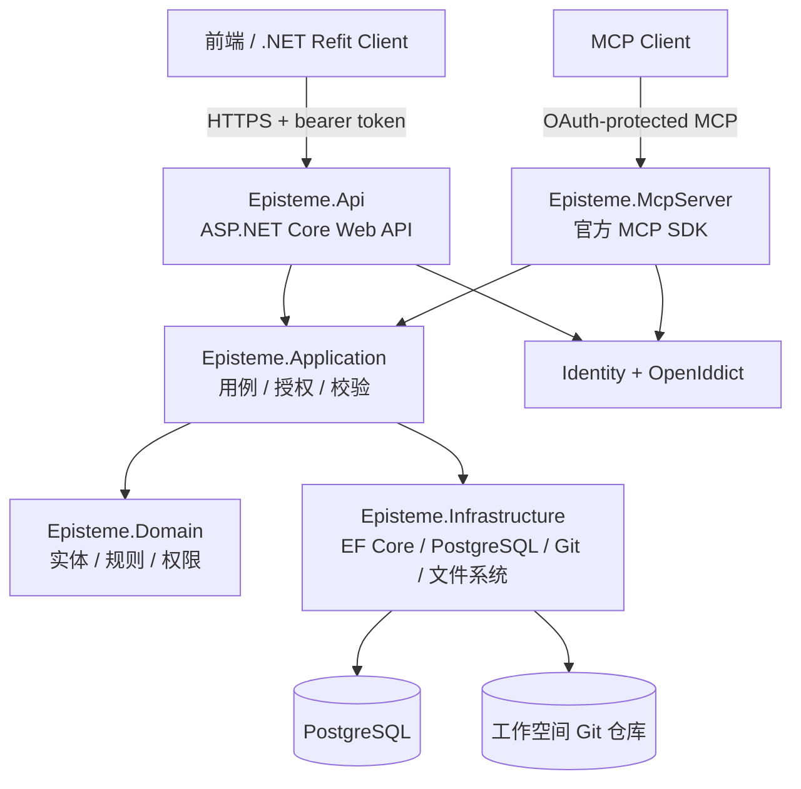

# 总体架构与组件选型

## 1. 架构目标

- 后端提供版本化 Web API 与 MCP 工具入口，统一复用应用用例和权限检查。
- 用户、授权和工作空间元数据存 PostgreSQL；每个工作空间有隔离的 Git 仓库，避免正文重复写入数据库。
- 所有业务代码位于 `src/`；方案文档位于 `design/`。
- 优先使用成熟组件及 .NET/ASP.NET 内建能力，不自建 OAuth/token、Git 历史或 MCP 协议实现。

## 2. 推荐技术组件

| 领域 | 选择 | 用途与边界 |
|---|---|---|
| Web/API | ASP.NET Core 10 Web API | HTTPS、API 路由、OpenAPI、认证中间件、标准 Problem Details。 |
| ORM / PostgreSQL | EF Core 10 + `Npgsql.EntityFrameworkCore.PostgreSQL` | Identity、OpenIddict 和 Episteme 元数据持久化；迁移由 EF Core 管理。 |
| 用户管理 | ASP.NET Core Identity + EF Core store | 密码哈希、用户生命周期、系统角色；不自行实现密码存储。 |
| OAuth/OIDC | OpenIddict + EF Core store + ASP.NET Core authentication | 标准 token 签发、刷新、撤销、client/scope 持久化；MCP/Web API 使用受众和 scope 校验。 |
| MCP | 官方 C# MCP SDK（Model Context Protocol） | 单独的 MCP Server 宿主和工具定义；远程连接优先使用受保护的 Streamable HTTP transport。只调用 Application 用例，不直接访问 EF/Git。 |
| HTTP API 客户端 | Refit | `Episteme.Client` 中的强类型 .NET API 客户端，供 .NET 前端/BFF/集成方调用；不是 Web API 服务端框架，也不用于 MCP 内部调用。 |
| Git 历史 | 系统 Git CLI + `CliWrap` | 每工作空间独立仓库；使用参数化进程调用而非 shell 拼接，显式检查退出码、超时和仓库路径。运维环境需安装受支持的 Git。 |
| API 文档 | ASP.NET Core OpenAPI | 从 API 契约生成规范；前端可使用生成器，具体前端栈待确认。 |
| 日志 | `Microsoft.Extensions.Logging` | 结构化日志抽象；日志禁止输出文档正文、token、密码和敏感配置。 |

> OpenIddict 面向需要标准 OAuth/OIDC token 生命周期的服务端方案。若产品最终确定只需单一第一方 API 且不需要标准 OAuth/OIDC/MCP 授权流，应重新评估认证方案，而不是额外叠加一套 token 实现。

## 3. 逻辑组件与请求流



API 和 MCP 分开部署/配置，但可共享 Application、Domain、Infrastructure 组件；MCP 不通过 Refit 回调 Web API，以免引入不必要的网络跳转和重复授权层。若后续出于部署简化希望同一进程托管两种 transport，可在确认安全边界后复用应用服务。

## 4. 目录布局提案

```text
.
├── Agent.md
├── design/
│   ├── README.md
│   ├── architecture.md
│   ├── domain-model.md
│   ├── erd.md
│   └── decisions.md
└── src/
    ├── Episteme.sln
    ├── Directory.Build.props
    ├── Directory.Packages.props
    ├── server/
    │   ├── Episteme.Api/                 # HTTP endpoints, composition root, auth
    │   ├── Episteme.McpServer/           # MCP tools, transport, MCP auth
    │   ├── Episteme.Application/         # use cases, ports, authorization
    │   ├── Episteme.Domain/              # entities, value objects, invariants
    │   └── Episteme.Infrastructure/      # EF Core, migrations, Identity, OpenIddict,
    │                                      # PostgreSQL, Git and filesystem adapters
    ├── clients/
    │   └── Episteme.Client/              # Refit interfaces and typed client registration
    └── tests/
        ├── Episteme.Domain.Tests/
        ├── Episteme.Application.Tests/
        └── Episteme.IntegrationTests/
```

依赖方向：`Api`、`McpServer` → `Application` → `Domain`；`Infrastructure` 实现 Application 定义的接口并由宿主组合注入。Domain 不依赖 EF Core、ASP.NET Core、Refit、MCP SDK 或 Git CLI。迁移与 provider 配置属于 Infrastructure。前端技术栈尚未确定，因此不在此预设框架；未来前端源码若放在同一仓库，也必须位于 `src/` 下。

## 5. 存储与安全边界

- 部署配置指定一个服务专用、非公开可访问的 `WorkspaceStorageRoot`；仓库物理目录使用不可变的服务端生成 `StorageKey`，禁止直接将用户传入路径拼接为物理路径。
- 用户“工作目录”是工作空间根目录下的逻辑相对目录；如确需用户指定本机绝对目录，应另行定义本地 Agent/桌面端的运行边界，不能默认开放服务端任意文件系统读写。
- 所有 API/MCP 文件操作要求 workspace ID + 规范化相对路径，且先鉴权再访问磁盘；拒绝符号链接逃逸、路径穿越、`.git` 访问、仓库锁文件和超出限制的请求。
- OAuth access token 设置短有效期；使用 refresh token 轮换/撤销策略和最低必要 scope。密钥只来自安全部署配置，不导出到工作空间清单或日志。
- 工作空间名称/slug 不决定物理路径。归档、成员变更、目录变更和恢复旧版本都要求授权与审计/提交记录。

## 6. MCP 工具边界提案

首批工具可覆盖：

- 工作空间：`list_workspaces`、`get_workspace`、`create_workspace`、`update_workspace`、`delete_workspace`（默认执行归档；物理清除仍须走受保护的保留期流程）。
- 目录：`list_directory`、`create_directory`、`move_directory`、`delete_directory`。
- 文档：`read_document`、`create_document`、`update_document`、`move_document`、`delete_document`。
- 版本：`get_document_history`、`restore_document_version`（通过新提交恢复，不改写历史）。
- 配置：`export_workspace_config`、`import_workspace_config`。

每个工具均以经过认证的主体上下文为准，不接受 caller/user ID 参数冒充身份。所有写工具校验角色、路径、输入大小及版本冲突；查询结果有分页/响应大小限制。MCP OAuth scopes 约束协议级能力，工作空间成员角色约束资源级能力，两者缺一不可。

## 7. 请求与事务约定

1. HTTP/MCP 入口验证 token、scope、请求格式。
2. Application 用例解析主体并进行工作空间级授权；禁止 Controller/Tool 直接操作 EF 或文件路径。
3. 元数据变更在 EF Core/PostgreSQL 事务内完成；Git/文件操作通过 Infrastructure 接口。
4. Git 写操作在仓库锁内执行，验证预期 HEAD 并产生单个新提交；失败显式返回可诊断错误。
5. API 使用一致的 Problem Details 错误形状；权限拒绝、路径非法、版本冲突、存储失败分别表达，不将失败伪装成空内容或成功响应。

Git 与数据库无法共享事务，因此初版把 Git 作为正文/目录/版本事实来源，管理审计与 Git 提交分工记录，避免把正文元数据重复存入 DB。后续若增加跨存储工作流，应单独设计可恢复状态机/对账任务，不假设分布式 ACID。
