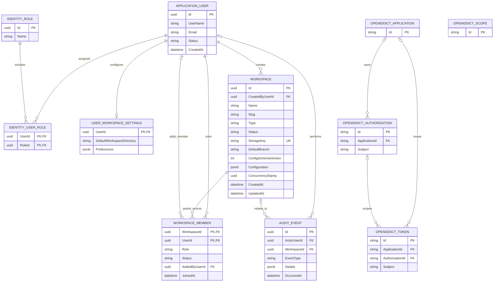
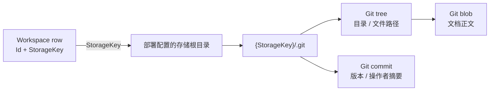

# 实体关系图

此图表示 PostgreSQL 中的持久化领域实体。Identity 和 OpenIddict 使用其官方 EF Core store 实体/表；文档、目录和版本不在数据库中，见图后的说明。

## 关系与约束

- `WORKSPACE_MEMBER` 是用户与工作空间的关联实体，主键/唯一约束为 `(WorkspaceId, UserId)`；角色为工作空间级角色。
- `Workspace.CreatedByUserId` 是创建审计关联，不自动代表永远的 Owner；Owner 权限以 `WorkspaceMember.Role` 为准，必须始终至少存在一个有效 Owner。
- `Workspace.StorageKey` 唯一且创建后不可修改，避免用户改名/slug 后仓库物理位置变化。
- 用户和工作空间使用软删除/停用语义；常规外键使用限制删除，避免级联删除仓库、审计或授权数据。
- OpenIddict 表实体字段由官方包的实体模型决定，图中仅表示关键关系，实际列不由项目自行重复定义。
- `WORKSPACE` 的配置存储为 PostgreSQL `jsonb`；配置字段必须有版本号并通过应用层校验。

## Git 仓库（数据库外）

